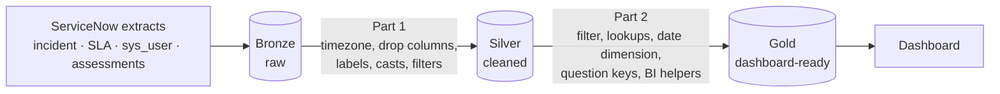

# Internal IT Ticketing: Medallion Pipelines (PySpark)

Two PySpark pipelines built in **Microsoft Fabric** that turn raw ServiceNow extracts into clean, dashboard-ready Delta tables using a **bronze → silver → gold** (medallion) architecture:

1. **Incident pipeline**: incidents, SLAs, users, agents and a date dimension.
2. **Survey pipeline**: post-ticket satisfaction surveys (ServiceNow assessment tables).

The gold tables feed a dashboard for our internal IT ticketing system (tickets by day and hour, resolve times, SLA performance, agent activity, satisfaction).

**Start here:** [`notebooks/01_incident_pipeline.ipynb`](notebooks/01_incident_pipeline.ipynb) and [`notebooks/02_survey_pipeline.ipynb`](notebooks/02_survey_pipeline.ipynb) · **Sample data for every layer:** [`data/`](data)

## Architecture



## What this project demonstrates

| Skill | Where |
|---|---|
| Medallion architecture with Delta tables (`overwrite` + `overwriteSchema`) | "Saving Tables" cells in both notebooks |
| Timezone handling: `from_utc_timestamp` UTC → `America/New_York` | Incident and SLA frames, bronze → silver |
| Conditional logic with `when/otherwise` for code → label mapping and rollups | `priority_text`, `state_text`, `state_status` |
| Derived time metrics (seconds → minutes/hours/days), zero-duration handling | `business_resolve_*`, SLA `business_duration_*` |
| Converting an epoch-offset `timestamp` duration into seconds | SLA frame (`duration_start`, `business_duration_secs`) |
| Multi-alias joins to resolve one lookup table four ways | `inc_agent_gold` (opened / assigned / resolved / closed by) |
| Row-level filtering (non-employees, noisy security tickets) | Incident pipeline, silver → gold |
| Building a **date dimension** with US holidays in pandas, promoted to Spark | `DimDateWorkday` |
| BI helper columns (hour buckets, "After Hours" sort key, active flag) | `created_hour`, `created_hour_sort`, `active_state` |
| Wide-table pruning: 123 → 32 SLA columns, 74 → 21 user columns, 63 → 25 question columns | Bronze → silver |
| Filtering by record source (`trigger_table`, `source_table`, survey type) | Survey pipeline |
| Explicit type casting (`cast(FloatType)`) for numeric survey fields | Survey silver |
| Parsing a composite key with `substring` to derive `question_id` / `question_instance_id` | Survey gold |
| Pivot-style columns with `when` (one column per survey question) | `value_satisfaction`, `value_resolved`, `value_repeat_issue` |
| **`left_anti` join** to drop whole survey groups that contain a test response | Survey gold |

## Before and after

### Shape of each layer (columns)

| Table | Bronze | Silver | Gold |
|---|---|---|---|
| Incident | 58 | 41 | 44 |
| SLA | 123 | 32 | 32 |
| Users | 74 | 21 | 21 |
| Agent lookup | n/a | n/a | 5 (new table) |
| Date dimension | n/a | n/a | 14 (new table) |
| Survey instance | 36 | 22 | 23 |
| Survey questions | 63 | 25 | 25 (rows filtered and sorted) |
| Survey answers | 30 | 19 | 24 |

Silver prunes unused columns and adds derived metrics; gold adds filtering and dashboard helper columns.

### One ticket through the pipeline: `INC0012973`

| Field | Bronze (raw) | Silver | Gold |
|---|---|---|---|
| `opened_at` | `2026-05-18 17:56:27` (UTC) | `2026-05-18 13:56:27` (Eastern) | same |
| `state` | `7` | `state_text = Closed`, `state_status = Closed` | same |
| `priority` | `3` | `priority_text = Medium` | same |
| `business_stc` (seconds) | `9957` | `business_resolve_hours = 2.7658` | same |
| Day / hour opened | n/a | `Monday`, `13`, `1 PM` | adds `created_hour_sort = 13` |
| Created date / active flag | n/a | n/a | `sys_created_date = 2026-05-18`, `active_state = 0` |

The same ticket in the SLA and agent tables:

| Table | Bronze | Silver / Gold |
|---|---|---|
| SLA `start_time` | `2026-05-18 17:56:27` | `2026-05-18 13:56:27` |
| SLA business duration | `1970-01-01 16:15:08` | `business_duration_secs = 58508`, `business_duration_hours = 16.2522` |
| `inc_agent_gold` | n/a | opened by *Abigail Burch*, assigned *Unassigned*, resolved by *Christopher Parker*, closed by *Melissa Gilbert* |

### One survey through the pipeline: assessment group `232e8b6f…ac4`

The answers table has one row per question. Silver keeps the raw text; gold parses the question code out of `assign_to_order` and splits the answer into one column per question.

| Question | Silver `assign_to_order` / `string_value` | Gold `question_id` | Gold `question_instance_id` | Gold value column |
|---|---|---|---|---|
| Satisfaction | `… - 100` / `5` | `100` | `232e8b6f…ac4-100` | `value_satisfaction = 5` |
| Resolved? | `… - 200` / `Yes` | `200` | `232e8b6f…ac4-200` | `value_resolved = Yes` |
| Repeat issue? | `… - 400` / `No` | `400` | `232e8b6f…ac4-400` | `value_repeat_issue = No` |

### Filters at work

- **Security tickets:** 29 of the 1,000 silver incident rows match the Security filter (a specific opener and assignment group); 0 of the gold incident rows do.
- **Employees only:** the gold users sample contains only `@company.com` addresses; in silver, 41 of 1,000 users have no email.
- **Survey source:** the bronze instance sample mixes three trigger tables (651 customer-service cases, 254 incidents, 56 request items); the silver sample keeps incidents only.
- **Survey type:** 221 of the 1,000 silver answer rows come from `change_request` surveys, which the gold filter excludes.
- **Test responses:** one silver assessment group contains a literal `Test` answer (6 rows); none of its rows appear in gold.

## Repository layout

```
internal-it-ticketing-medallion/
├── README.md
├── requirements.txt
├── .gitignore
├── notebooks/
│   ├── 01_incident_pipeline.ipynb    # Part 1: Bronze→Silver, Part 2: Silver→Gold
│   └── 02_survey_pipeline.ipynb      # Part 1: Bronze→Silver, Part 2: Silver→Gold
└── data/
    ├── README.md                     # file list, row/column counts, notes
    ├── bronze/                       # raw extracts
    ├── silver/                       # cleaned
    └── gold/                         # dashboard-ready (+ dimdate.csv, inc_agent_gold.csv)
```

## Running it

The notebooks are written for **Microsoft Fabric**, where `spark` is provided and the lakehouse tables (`internal_it_100b_lkh`, `internal_it_200s_lkh`, `internal_it_300g_lkh`) already exist. The sample CSVs in `data/` are extracts of those tables.

To explore the samples locally:

```bash
pip install -r requirements.txt
```

```python
import pandas as pd
bronze = pd.read_csv("data/bronze/inc_incident_bronze.csv")
gold   = pd.read_csv("data/gold/inc_incident_gold.csv")
bronze[["number", "opened_at", "state"]].head()
gold[["number", "opened_at", "state_text", "priority_text"]].head()

answers = pd.read_csv("data/gold/asmt_answers_gold.csv")
answers[["question_id", "value_string", "value_satisfaction"]].head()
```

## Tech stack

PySpark (Microsoft Fabric / Synapse runtime) · Delta Lake · pandas · `holidays` · ServiceNow data model

## Known limitations and next steps

- Incident `state = 8` (Canceled in ServiceNow) currently falls into the `ERROR` bucket of `state_text` and `state_status`; adding it to the mapping is a small follow-up.
- The date dimension ends at `date.today()` on each run, so it grows over time; a fixed or configurable end date would make runs reproducible.
- Database names and a few ServiceNow ids (survey type, source id prefix) are hard-coded in the notebooks; moving them into a config cell would make them easier to reuse.
